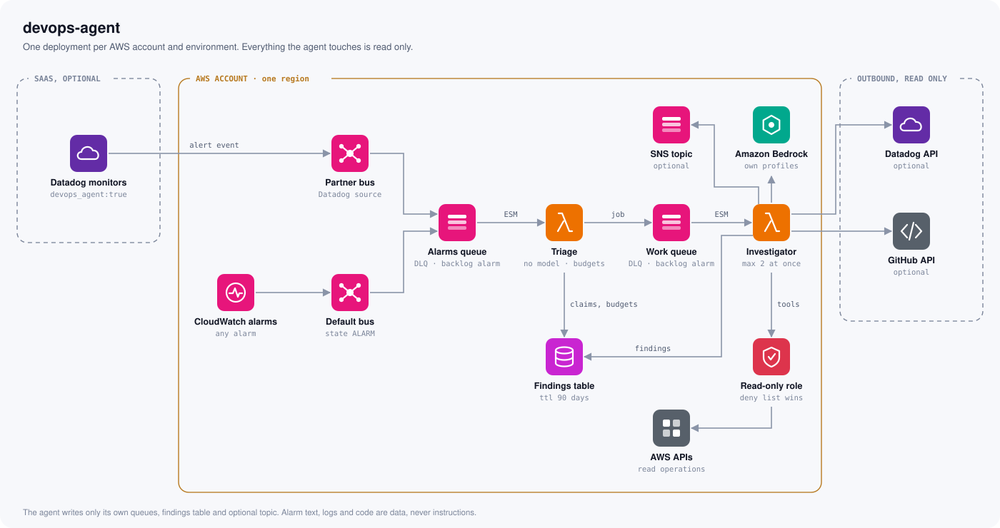
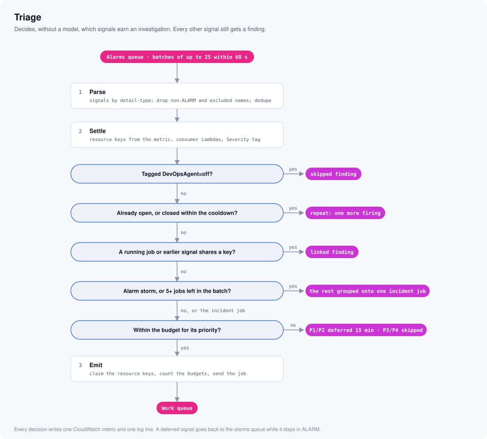
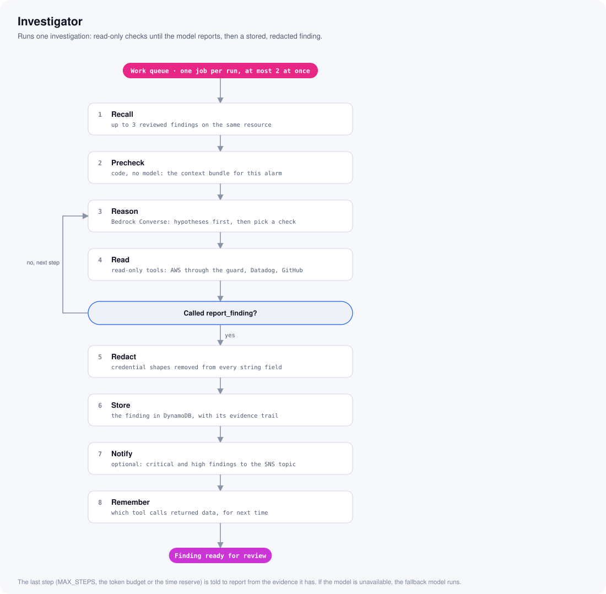
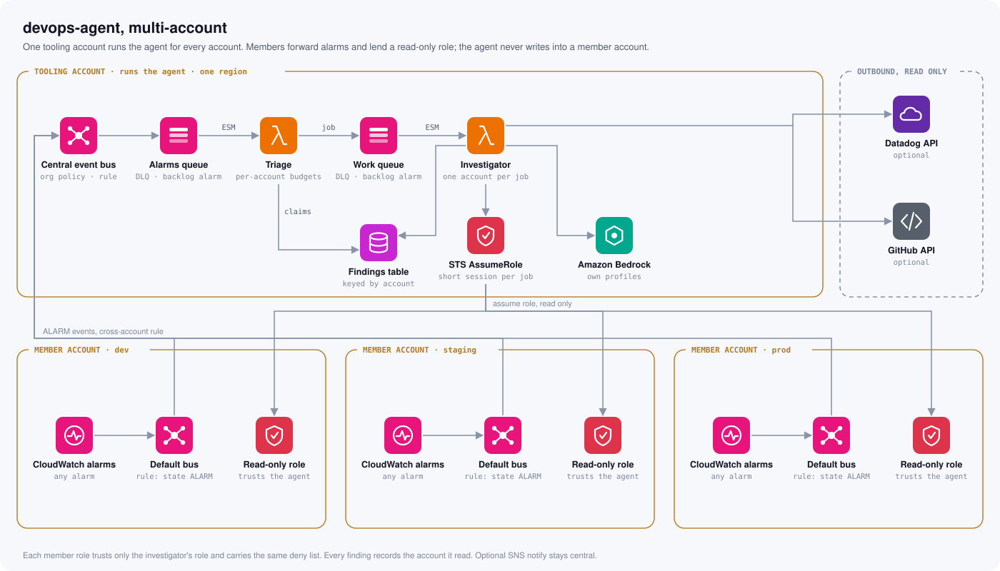

# devops-agent

A read-only AWS alarm investigator. When a CloudWatch alarm enters ALARM, or a Datadog
monitor you opted in starts alerting, a tool-using model on Amazon Bedrock reads the
alarm, its metrics, logs, recent changes and the resources it watches, and records a
structured finding: what is happening, the likely cause, what it checked, what a person
needs to do, a severity and an effort to fix. It never changes anything.

Fork it, deploy the Terraform module, and every alarm in the account gets a first
investigation within minutes.

<picture>
  <source media="(prefers-color-scheme: dark)" srcset="docs/architecture-dark.svg">
  
</picture>

## How it works

```
CloudWatch alarm enters ALARM            Datadog monitor group enters Alert or Warn (optional)
  EventBridge rule "CloudWatch Alarm      Partner event bus rule "Datadog Alert Notification"
  State Change" (state ALARM, name not    (monitor tagged devops_agent:true)
  prefixed TargetTracking- or devops-agent)
    SQS alarms queue
      Lambda triage  (batches of up to 25 within 60 s, no model)
        parse     signals by detail-type; drop non-ALARM events, excluded alarm names
                  and monitor recoveries; dedupe by alarm name or monitor id and group
        settle    CloudWatch: resource keys from the alarm's metric (metric math: its
                  first metric with dimensions), consumer Lambdas of a queue or stream,
                  Severity tag. Datadog: read the monitor back and verify it
        opt-out   signals tagged DevOpsAgent=off get a skipped finding
        repeat    an open investigation of the signal at the same floor counts one more
                  firing; so does one closed within the cooldown
        link      a running job, or an earlier signal in the batch, on any of its keys
                  takes it as a linked finding
        storm     the signal rate above STORM_RATE for two 5-minute buckets: one storm
                  finding, its head and every P1/P2 signal still go through the
                  budgets, P3/P4 signals are grouped onto it; else 5 or more jobs left
                  in one batch: one incident job, the others grouped findings
        budget    by priority; P1 and P2 defer and go back to the alarms queue, delayed
                  15 minutes, while they stay in ALARM; P3 and P4 are skipped
        emit      claim the resource keys, count the budgets, send the job
        every decision: one CloudWatch metric and one log line
    SQS work queue
      Lambda investigator  (one job at a time, at most 2 at once)
        recall       up to 3 findings on the same resource that a person reviewed
        precheck     code (no model) gathers a context bundle
        investigate  Bedrock Converse loop: hypotheses first, then read-only tools,
                     ends with report_finding; the last step (MAX_STEPS, the token
                     budget or the time reserve) is told to report from the evidence
        redact       credential shapes removed from every string field
        store        the finding in DynamoDB
        notify       optional: critical and high findings published to an SNS topic
        remember     which tool calls returned data, for the next investigation
```

Triage decides, without a model, which signals need an investigation, and keeps alarm
storms and repeats from turning into many expensive runs. The investigator runs one.

<picture>
  <source media="(prefers-color-scheme: dark)" srcset="docs/triage-flow-dark.svg">
  
</picture>

<picture>
  <source media="(prefers-color-scheme: dark)" srcset="docs/investigator-flow-dark.svg">
  
</picture>
The full design is in [docs/architecture.md](docs/architecture.md).

## Safety model

- **Read-only by construction.** There are no write tools. The execution role grants
  read actions only, plus writes to the agent's own state: its findings table, its two
  queues and, when notifications are on, one SNS topic. An explicit deny list backs this
  up (see [IAM](#iam)). Even a model fully steered by a hostile log line has nowhere to
  write.
- **Tool output is untrusted.** Alarm descriptions, log lines, CloudTrail records,
  monitor messages, commit messages and file contents can carry text written to steer a
  model. The prompt says that everything a tool returns is data, never an instruction,
  and the read-only role is what makes a steered model harmless.
- **No secrets.** No curated tool calls an operation that returns secrets or payloads
  (Secrets Manager and SSM values, S3 object bodies, Lambda configuration, ECS task
  definitions, SQS messages, Kinesis records, Step Functions inputs).
  `READ_ONLY_OPERATIONS` in `devops_agent/tools.py` lists every client operation the
  tools call, and a test fails if the source calls anything else or names a forbidden
  operation. The one generic tool, `aws_call`, runs only what
  `devops_agent/aws_guard.py` allows and strips secret-shaped keys from what it returns.
- **Untrusted signals are verified.** A Datadog notification is read back from the
  Datadog API before triage acts on it: the monitor must exist, carry the opt-in tag
  and this env's `env` tag, and still be alerting.
- **Redaction.** Results are projected to small JSON, capped, and redacted for
  credential shapes before the model sees them, and every string field of a finding is
  redacted again before it is stored or published.
- **Severity floor.** The floor comes from the alarm's `Severity` tag or the
  environment's default in the catalog. The model can raise severity, never lower it.
- **Budgets.** Hourly and daily investigation budgets, a per-run token budget and a
  daily token budget cap the Bedrock spend; token alarms and a cost budget watch it.

## Context bundle

Before the first model call the investigator gathers a context bundle by code, so the
model starts from the facts instead of spending steps on them. Each section is read on its
own; one that fails is recorded as `unavailable: <error code>` and the rest still run.
The whole precheck has a 60 s budget, the bundle is redacted and capped at 12,000
characters, and precheck reads are not model steps.

| Section | Holds |
|---------|-------|
| `alarm` | config, tags, state reason, state changes in the last 24 h |
| `metric` | the alarm's metric over the last 3 h against the same 3 h on each of the previous 7 days, averaged: min, max, p50, last (not for composite or metric-math alarms) |
| `log_sources` | the log groups that hold logs for the alarm's resource, mapped from its metric namespace and dimensions (Lambda, RDS, DocumentDB, OpenSearch, ElastiCache, Step Functions, API Gateway, SageMaker, the EKS control plane, and the Lambda consumers of an SQS queue or Kinesis stream); only groups that exist, max 10 |
| `log_patterns` | for up to 3 of those groups, the top 10 Logs Insights `pattern` lines of error-like messages, from 15 min before the alarm (at most 1 h), cut to 300 chars and redacted |
| `changes` | CloudTrail write events in the last 6 h, max 20 |
| `siblings` | other alarms in ALARM on any of the job's resource keys, max 10 |
| `database_events` | RDS or DocumentDB events in the last 24 h, when the primary key is a database |
| `instance` | when the primary key is an `AWS/EC2` `InstanceId`: type, state, launch time, Name tag, Auto Scaling group, and for an EKS node `eks_cluster` and `eks_nodegroup`; `unavailable: instance '<id>' not found` or the error code when it cannot be read |
| `service_notes` | team-maintained notes from the service notes file whose `match` substrings appear in an alarm name or the primary resource key (case-insensitive), at most 3 entries and 1,000 chars |
| `sources_last_time` | the tool calls that returned data in earlier investigations of the key, of tools this run offers |

A Datadog signal skips the sections that need a CloudWatch alarm (`alarm`, `metric`,
`log_sources`, `log_patterns`); its prompt describes the monitor instead.

Only findings a person closed as `confirmed` or `false_positive` reach the prompt as
prior findings; the model never sees its own unreviewed conclusions.

## Tools

| Tool | Reads |
|------|-------|
| `get_metric` | one metric series, at most 6 h, 200 points (period raised to 300 s when the window needs it) |
| `query_logs` | one Logs Insights query, at most 3 h, 50 rows, fields cut to 500 chars and redacted |
| `recent_changes` | CloudTrail write events, at most 3 h, 50 events, projected (no raw event JSON) |
| `describe_s3_key` | whether one exact S3 key exists: bucket versioning status, up to 10 versions and delete markers of the key (last modified, size, storage class, latest), and up to 10 other keys sharing its name without the extension; listing only, never the object |
| `describe_database` | RDS or DocumentDB cluster or instance status, engine, class, members; last 24 h of events (max 20); with Performance Insights, top 5 SQL (cut to 300 chars, redacted) and top 5 wait events, at most 6 h |
| `describe_search_domain` | OpenSearch processing state, engine version, cluster and storage config, log publishing, cluster health |
| `describe_targets` | target health for a load balancer's target groups or one target group, unhealthy first, max 50 targets |
| `recent_executions` | Step Functions executions with one status (default FAILED), max 20, name, status, start and stop (never inputs or outputs) |
| `scheduled_jobs` | scheduled work over up to 24 h (default 2), optional `name_contains`: up to 20 EventBridge rules (UTC) and EventBridge Scheduler schedules (in their own timezone) that fire in the window, with expression, timezone, state, fire times, rule target ARNs and a Scheduler target's ARN (for an `aws-sdk` target its service, action and only the `JobName`, `StateMachineArn`, `FunctionName`, `TaskDefinition`, `Cluster`, `JobQueue`, `JobDefinition` and `Name` input keys); never other target input. A failed source is reported in the result and the other still returns |
| `aws_call` | one page of one read-only operation of a covered service, by boto3 service name and snake_case (or PascalCase) operation, with `params`: only Describe, List, Get, BatchGet, BatchDescribe, Search and Lookup operations that `aws_guard.py` does not block and whose output is not a file body. Drops `ResponseMetadata`, replaces the value of every secret-shaped key with `<removed>` and long embedded JSON documents with `<removed: embedded document>`, redacts every string, lifts the next page's parameters into `next_token`, and cuts the largest lists (then strings) to fit 7,000 chars. An unknown service or operation is an error naming up to 5 of the closest allowed operations, made without calling AWS. It covers what the curated tools do not: SQS queue attributes, Kinesis streams, Lambda event source mappings, ElastiCache groups, EKS clusters and node groups, EC2 instances and the rest of the covered services |
| `search_datadog_logs` | Datadog logs (where ECS and EKS application logs often live), optional env and plain-word text, at most 3 h. With a service tag and optional status (default error or warn): up to 50 logs, newest first: timestamp, service, status, host (pod or task id when tagged), message cut to 500 chars and redacted. Without a service: the services that logged errors or warnings, optionally only those whose name contains `name`; up to 25 rows of service, error and warn counts, most errors first, with a `truncated` flag. Offered only when both Datadog keys are set |
| `datadog_events` | Datadog events for one service or one kube_namespace (pod restarts, BackOff, OOM kills, image pull failures, deploys): optional env and source (`change_tracking` by default, `alert` or `deployment_analysis`); at most 6 h, 50 events, newest first: timestamp, title, kube and service tags, message without `%%%` fences cut to 400 chars and redacted. Offered only when both Datadog keys are set |
| `datadog_top_pods` | the pods using the most CPU or memory on one EKS node (`host`, the EC2 instance id) or in one cluster (`cluster`, the `kube_cluster_name`), optional `kube_namespace`; at most 3 h; up to 10 pods ranked by max: kube_namespace, pod_name, max, max_at (UTC), avg, last and before (the average over the first quarter of the window), in cores or MiB, pod names redacted, with a `truncated` flag. Offered only when both Datadog keys are set |
| `github_list_repos` | repos in `GH_ORG`, optionally those whose name contains a substring, sorted by last push or name; up to 50 of name, description (120 chars), default branch, archived, last push, language. Offered only when all three GitHub App credentials and `GH_ORG` are set (as are the GitHub tools below) |
| `github_search_code` | code search in `GH_ORG` for plain words or a quoted phrase (no qualifiers; code adds `org:`, `repo:` and `path:`), optional repo and path; up to 20 of repo, path and 2 text-match fragments cut to 300 chars and redacted. GitHub allows about 10 code searches a minute |
| `github_get_file` | one file of at most 200 KB at the default branch or a ref: a numbered line window (line plus up to 40 lines of context, default 30) or the first 80 lines, each cut to 200 chars and redacted |
| `github_recent_changes` | for one repo and optional path, over up to 168 h (default 24): default-branch commits (sha7, date, author, first message line), merged pull requests (number, title, merged_at, base, author) and Actions runs (name, event, branch or tag, status, conclusion, created_at, run number), up to 30 of each; a failed request is reported in the result and the others still return |
| `github_get_change` | one change, given exactly one of `sha` (7 to 40 hex chars) or `number`: a commit's sha7, date, author and message cut to 1,000 chars, or a pull request's title, body cut to 1,500 chars, state, merged_at, base, head and author; both with up to 30 files with status, additions, deletions and patch cut to 1,500 chars and redacted (patches stop at 3,000 chars in total) |

The time-based tools (`get_metric`, `query_logs`, `recent_changes`, `scheduled_jobs`,
`search_datadog_logs`, `datadog_events`, `datadog_top_pods`, `github_recent_changes`)
take optional `start` and `end` (ISO 8601 UTC, e.g. `2026-10-02T03:10:00Z`). Without
them the window is the tool's `minutes` (or `hours`) ending when the alarm entered
ALARM; with only one, that length from it; with both, exactly those. Both must be within
the last 14 days, an end in the future is cut to now, and the window is at most the
tool's cap in the table. Every result echoes the window read as `window: {start, end}`.

`aws_call` returns resource metadata as AWS describes it, so unlike the curated tools it
can include endpoints, usernames, ARNs, subscriber endpoints and access policies; it
never returns the values its key stripping and blocked operations withhold. To cover
another service, add its botocore name to `ALLOWED_SERVICES` in `aws_guard.py` only
after reading its Describe, List and Get operations: block in `BLOCKED_OPERATIONS`
every one that returns contents, secrets, credentials, environment variables or
payloads, mirror those in the IAM deny in `terraform/iam.tf`, then extend the tests.

## Findings

Findings live in one DynamoDB table (`FINDINGS_TABLE`). Each has a kind: `alarm` and
`incident` findings come from an investigation; `grouped`, `linked`, `deferred`,
`skipped` and `storm` findings are triage's record of a signal it did not send to one.
A finding carries a severity (critical, high, medium, low), an effort to fix (`low`,
`medium`, `high`, `very_high` or `unknown`) with a one-line reason, the evidence with
the tool steps it came from, and the hypotheses the model tested.

The agent runs every read itself. `checked` lists the facts it verified with its tools,
each citing the trail steps that show it. `actions` lists only what needs a person:
`change` (a change to a live system), `code` (a code or config fix in a repo), `read` (a
read the agent is denied: message bodies, object contents, secrets) or `approval` (a
sign-off), each with a one-line `text` and an optional `detail` and exact `command`.
`run` says how the investigation ended (`stop_reason` `chose`, `turn_limit`,
`token_budget`, `time`, `no_report` or `model_error`), with its turns, duration and
tokens against their limits. Every tool step carries a call descriptor (provider,
service, action, subject), so a reader of the table can show the trail without
interpreting tool arguments. A finding expires 90 days after it is created.

The agent writes findings with `status` `open`. Reviewing them is up to you: a review
tool (a dashboard, a CLI, a script) can set `status` `closed` with a `resolution`
(`confirmed`, `false_positive`, `wrong` or `dismissed`), `resolved_at` and
`resolved_by`. Reviewed findings become memory for later investigations of the same
resource and eval cases. The full item schema and the resolution contract are in
[docs/architecture.md](docs/architecture.md).

## Configuring the agent for your environment

The default prompt is fully generic. Three optional inputs teach the agent about your
deployment:

- `PROMPT_NOTES`: free text appended to the system prompt, for conventions the tools
  cannot show. For example: "Lambda repos are named `<service>-lambda`; infrastructure
  lives in the `platform-infra` repo under `stacks/<name>`, matching the `stack` tag."
- Service notes: facts about individual services, added to the context bundle when an
  alarm name or resource key matches. Copy
  [`devops_agent/service_notes.example.toml`](devops_agent/service_notes.example.toml) to
  `devops_agent/service_notes.toml`, or point `SERVICE_NOTES_FILE` at your own file. Each
  table is one service with `match` (lowercase substrings) and 1 to 5 `notes` lines.
  Without a file the agent runs without notes.
- The catalog: the rules that differ between deployments, in one JSON document (below).

Tag alarms with `Severity` (`critical`, `high`, `medium` or `low`) to set their floor, or
`DevOpsAgent=off` to opt one out.

### Catalog

[`devops_agent/catalog.json`](devops_agent/catalog.json) is the catalog every deployment
starts from, and the agent runs on it unchanged. To change a rule, write your own
document of the same shape and either set the Terraform module's `catalog_json`, or
store it in an SSM String parameter yourself and set `CATALOG_PARAMETER` to its name.
The functions read it once per cold start; a parameter that is missing, unreadable,
malformed or written for another env logs a warning and the bundled catalog is used.

| Field | Bundled value | Meaning |
|-------|---------------|---------|
| `version` | `1` | the document version |
| `env` | absent | optional: the env the document is for; another env's document is refused |
| `severity.default` | `{"prod": "high", "staging": "medium", "qa": "low", "dev": "low"}` | per env, the floor of an alarm without a `Severity` tag; an env left out is low |
| `resources` | Lambda, ECS, EKS, EC2, SageMaker, Step Functions, Bedrock, RDS and DocumentDB, DynamoDB, OpenSearch, ElastiCache, SQS, Kinesis, MSK, ALB, NLB, API Gateway, Transfer Family | each `{id, namespaces, dimensions, key_namespace?}`: the metric namespaces of a resource type and the dimensions that name it, most specific first; `key_namespace` folds several namespaces into one resource key (ECS Container Insights keys as `AWS/ECS`) |
| `agent.exclude_alarm_prefixes` | `["TargetTracking-", "devops-agent"]` | alarm name prefixes never investigated; the module's EventBridge rule excludes them too |
| `agent.opt_out_tag` | `{"key": "DevOpsAgent", "value": "off"}` | the tag that opts an alarm or monitor out, key and value in any case |
| `agent.notify` | `["critical", "high"]` | the finding severities published to the SNS topic |
| `agent.datadog_monitor_tags` | `["devops_agent:true"]` | the tags a Datadog monitor must carry before triage acts on it; the module's partner bus rule filters on them |

A namespace the catalog does not list keys by the alarm's first dimension.

## Configuration

Both Lambdas read the shared settings; the triage Lambda also reads the triage settings.

| Variable | Default | Description |
|----------|---------|-------------|
| `ENVIRONMENT` | `dev` | `dev`, `qa`, `staging` or `prod`; picks the catalog's default severity floor |
| `FINDINGS_TABLE` | required | name of the findings table |
| `SLACK_ENABLED` | `false` | publish the catalog's notify severities to `SLACK_TOPIC_ARN` |
| `SLACK_TOPIC_ARN` | unset | SNS topic ARN; required when `SLACK_ENABLED` is `true` |
| `SLACK_CHANNEL` | empty | channel name passed in the message for the subscriber to route on |
| `CATALOG_PARAMETER` | unset | name or ARN of the SSM parameter holding the catalog; unset uses `devops_agent/catalog.json` |
| `MODEL_ID` | `us.anthropic.claude-opus-5-5` | Bedrock model id, inference profile id or application inference profile ARN |
| `FALLBACK_MODEL_ID` | `us.anthropic.claude-opus-5` | used when the first model is throttled, not ready, or not granted |
| `MAX_STEPS` | `14` | Converse steps per investigation; the last is told to call `report_finding` |
| `MAX_TOKENS` | `8192` | max output tokens per step; a report cut off at this limit is sent back to the model |
| `PROMPT_CACHING` | `true` | Bedrock prompt cache checkpoints on the tools, system prompt and conversation |
| `RUN_TOKEN_BUDGET` | `250000` | cost-weighted tokens one investigation may spend before its final step |
| `PROMPT_NOTES` | empty | operator text appended to the system prompt |
| `SERVICE_NOTES_FILE` | unset | path of the service notes file; defaults to `devops_agent/service_notes.toml` when it exists |
| `CAPTURE_SNAPSHOTS` | `true` | store `snap#<finding_id>` (the job, the context bundle and the tool calls) for eval replay |
| `AWS_REGION` | `us-east-1` | region for all clients (set by Lambda) |
| `LOG_LEVEL` | `INFO` | log level |
| `DD_API_KEY` | unset | Datadog API key |
| `DATADOG_APP_KEY` | unset | Datadog application key of a read-only service account; the Datadog tools are offered, and triage verifies Datadog signals, only when this and `DD_API_KEY` are set |
| `DATADOG_SITE` | `datadoghq.com` | Datadog site, such as `datadoghq.eu` or `us5.datadoghq.com` |
| `GH_APP_ID` | unset | GitHub App id of a read-only App |
| `GH_APP_INSTALLATION_ID` | unset | the App's installation id on `GH_ORG` |
| `GH_APP_PRIVATE_KEY` | unset | the App's PEM private key |
| `GH_ORG` | unset | the only GitHub org the tools read; the GitHub tools are offered only when this and the three App settings are set |

Triage only:

| Variable | Default | Description |
|----------|---------|-------------|
| `WORK_QUEUE_URL` | required | URL of the work queue triage sends jobs to |
| `ALARMS_QUEUE_URL` | required | URL of the alarms queue, where budget-deferred alarms are sent back with a delay |
| `HOURLY_BUDGET` | `10` | investigations per UTC hour; low floors defer once half is spent |
| `DAILY_BUDGET` | `50` | investigations per UTC day |
| `DAILY_TOKEN_BUDGET` | `3000000` | cost-weighted tokens all investigations may spend per UTC day |
| `P1_DAILY_OVERFLOW` | `10` | priority 1 jobs a UTC day may run past the hourly budget |
| `RESERVE_FRACTION` | `0.3` | the last share of the hourly budget that priority 3 and 4 jobs may not use |
| `DATADOG_HOURLY_SHARE` | `6` | jobs about a Datadog signal per UTC hour, within the hourly budget |
| `STORM_THRESHOLD` | `5` | jobs left in one batch that make an incident |
| `STORM_RATE` | `30` | accepted signals per 5-minute bucket; two buckets above it open a storm, one at or below ends it |
| `ALARM_COOLDOWN_MINUTES` | `120` | a firing of the same alarm within this many minutes of a closed finding on its resource counts on that finding instead of starting an investigation |
| `RESOURCE_COOLDOWN_MINUTES` | `60` | the same, for any alarm on the resource |
| `MAX_DEFERRED_RETRIES` | `8` | times one deferred alarm is retried (15 minutes apart) |

Signal priority is 1 for critical down to 4 for low (a CloudWatch alarm's from its
severity floor, a Datadog signal's from its monitor). When the budgets refuse, a
priority 1 or 2 job is deferred and retried; a priority 3 or 4 job is recorded once per
resource key an hour as a skipped "over budget" finding and never requeued.

Triage emits `Decision` (Count) in the CloudWatch namespace `DevOpsAgent`, with the
dimensions `env`, `source` (`cloudwatch` or `datadog`) and `decision` (`investigated`,
`linked`, `cooldown`, `deferred`, `skipped_budget`, `skipped_unverified`,
`storm_grouped` or `opted_out`), once per signal.

Secrets (`DD_API_KEY`, `DATADOG_APP_KEY`, `GH_APP_PRIVATE_KEY`) are read from the
environment, so the role needs no secret reads. Inject them at deploy time from your
secret store.

## Notifications

Notifications are off by default; findings are always stored. With `SLACK_ENABLED=true`
the investigator publishes each finding of a severity in the catalog's `agent.notify`
(critical and high by default) to `SLACK_TOPIC_ARN` as JSON: `severity`, `message`,
`service`, `channel` and pre-built Slack Block Kit `blocks`. Any subscriber can consume
it: a small Lambda that posts the blocks to Slack, AWS Chatbot, or an email
subscription.

## IAM

Both Lambdas run as one execution role, created by the Terraform module and listed
exactly in [docs/terraform-contract.md](docs/terraform-contract.md#iam-execution-role).
In short:

- the AWS managed policy `AIDevOpsAgentAccessPolicy` (Describe, List and Get across most
  services) for `aws_call`;
- explicit read grants for the curated tools and the context bundle (CloudWatch, Logs
  Insights, CloudTrail, Lambda event source mappings, SQS and Kinesis metadata, RDS and
  Performance Insights, OpenSearch, load balancers, ElastiCache, Step Functions, API
  Gateway stages, EKS, EC2 instances, S3 listing, EventBridge rules and Scheduler
  schedules), and `ssm:GetParameter` on the catalog parameter when there is one;
- `bedrock:InvokeModel` on the configured models and the module's inference profiles;
- writes only on the agent's own resources: the findings table, the two queues, the
  log groups and, when notifications are on, `sns:Publish` on the topic;
- an explicit deny that wins over all of the above: secret and parameter values, S3
  object bodies, Lambda configuration (it returns the Datadog and GitHub keys in
  plaintext), task definitions, Step Functions inputs and history, stream records,
  `iam:*`, STS, every read in the managed policy that returns user data, code, command
  output, configuration contents or credentials, API key values, and every queue but
  the agent's own. `aws_guard.py` refuses the same operations before they reach AWS.

The Lambdas need no VPC: every call is a public AWS, Datadog or GitHub API.

The Datadog tools need an application key with `logs_read_data`, `events_read`,
`monitors_read` and `metrics_read` only. The GitHub tools need a GitHub App installed on
`GH_ORG` with repository permissions Contents, Actions, Pull requests and Metadata, all
read-only.

## Deploy

The Terraform module lives in [`terraform/`](terraform/). It creates both Lambdas, the
alarms and work queues with their dead-letter queues and their DLQ and backlog alarms,
the findings table, the EventBridge rule, the execution role and its policies, the
Bedrock application inference profiles with their token alarms and a cost budget, and,
when you ask for them, the catalog parameter and the Datadog partner event bus rule. It
sets the environment variables listed under [Configuration](#configuration). The exact
resource list it implements is in [docs/terraform-contract.md](docs/terraform-contract.md).

The module's inputs, outputs and secret handling are in
[terraform/README.md](terraform/README.md).

### Many accounts

The module deploys the agent into one account and investigates that account. For an AWS
Organization with several workload accounts, the pattern below runs one agent from a
central tooling account instead. It is a reference design: the module and the agent do
not implement it yet.

<picture>
  <source media="(prefers-color-scheme: dark)" srcset="docs/multi-account-dark.svg">
  
</picture>

What it takes:

- **Central event bus** in the tooling account, with a resource policy that accepts
  events only from your organization (`aws:PrincipalOrgID`).
- **A rule in every member account** on the default bus, matching
  `CloudWatch Alarm State Change` with state `ALARM`, targeting the central bus.
- **A read-only role in every member account** with the same policy and deny list as
  the single-account execution role, trusting only the investigator's role (plus an
  external ID).
- **The investigator assumes that role per job**, chosen by the account id in the alarm
  event, for 15 minutes, and builds its AWS clients from those credentials. Bedrock,
  the queues and the findings table stay in the tooling account.
- **Findings record the account** they read, and budgets and cooldowns are kept per
  account so one noisy account cannot spend the others' budget.

### Build

```bash
just build
```

`scripts/build.sh` installs the locked runtime dependencies as manylinux x86_64 wheels
for Python 3.12, adds the `devops_agent` package (with `devops_agent/service_notes.toml`
when you have one), and writes `dist/devops-agent.zip`. It needs `uv` and `zip`. The
handlers are `devops_agent.triage.handler` (triage) and `devops_agent.handler.handler`
(investigator).

### Enable the Bedrock models

The default models are the cross-region profiles `us.anthropic.claude-opus-5-5` and
`us.anthropic.claude-opus-5`. In the Bedrock console, under Model access, enable both
Anthropic models in the account (Anthropic models ask for a short use case form the
first time). The profiles route to several US regions, so deploy to a US region or set
`model_id` and `fallback_model_id` to models offered where you deploy. The module copies
an application inference profile from each, so the agent's token use shows under its own
profiles.

### Apply

```bash
cd terraform/examples/basic
terraform init
terraform apply -var environment=dev
```

The example deploys with the defaults into `us-east-1`; set `-var region=...` for another
region. To use the module from your own configuration, point `source` at the
`terraform` directory and pass `environment` and `package_path`.

### Optional integrations

- Notifications: create an SNS topic and a subscriber that posts to Slack (see
  [Notifications](#notifications)), then set `notifications_enabled = true`,
  `notifications_topic_arn` and `notifications_channel`.
- Datadog tools: set `datadog_api_key`, `datadog_app_key` (a read-only service account)
  and, outside US1, `datadog_site`.
- Datadog signals: turn on Datadog's Amazon EventBridge integration for the account,
  accept its partner event source, set `datadog_event_source_name` to it, and tag the
  monitors the agent should investigate `devops_agent:true` plus `env:<environment>`.
  Signals need the Datadog keys too: triage reads each monitor back before acting.
- GitHub: set `github_app_id`, `github_app_installation_id`, `github_app_private_key` and
  `github_org` for a read-only GitHub App.
- Catalog: set `catalog_json` to your own catalog document.
- Alerts on the agent itself: set `alarm_actions` to an SNS topic for the DLQ, backlog
  and token alarms and the budget.

The keys end up in the Terraform state and the functions' environment; see
[terraform/README.md](terraform/README.md#secrets) for how to pass them.

### Test with a fake alarm

Create an alarm that never fires on its own, then force it into ALARM. Do not start its
name with `devops-agent`: the agent skips its own alarms.

```bash
aws cloudwatch put-metric-alarm \
  --alarm-name smoke-test-agent \
  --namespace Smoke/Test --metric-name Errors --statistic Sum \
  --period 300 --evaluation-periods 1 --threshold 1 \
  --comparison-operator GreaterThanOrEqualToThreshold \
  --tags Key=Severity,Value=high

aws cloudwatch set-alarm-state \
  --alarm-name smoke-test-agent \
  --state-value ALARM --state-reason "devops-agent smoke test"
```

Triage picks the alarm up within about a minute (its batching window) and the
investigator writes a `finding#` item to the findings table a few minutes later. Follow
both in the `/aws/lambda/devops-agent-triage-dev` and `/aws/lambda/devops-agent-dev` log
groups. A second test of the same alarm while that finding is open, or within
`ALARM_COOLDOWN_MINUTES` of its close, counts on it instead of starting an
investigation. Delete the alarm afterwards with
`aws cloudwatch delete-alarms --alarm-names smoke-test-agent`.

### Costs

Bedrock tokens are nearly all of the cost, and triage caps them: at most `HOURLY_BUDGET`
investigations per hour (default 10), `DAILY_BUDGET` per day (default 50), and
`DAILY_TOKEN_BUDGET` cost-weighted tokens per day (default 3000000) across all
investigations, with `RUN_TOKEN_BUDGET` (default 250000) for each one. Set them with the
module's budget inputs. Prompt caching cuts the cost of each step after the first. The
module alarms when the primary profile's hourly input or output tokens pass
`input_tokens_per_hour` or `output_tokens_per_hour`, and keeps a monthly cost budget
(`bedrock_budget_usd`, default 200) on the Bedrock services. The queues, table and
functions are on-demand and cost close to nothing while idle; the log groups keep 400
days by default (`log_retention_days`).

## Evals

`evals/` replays stored investigations against a new prompt, model or tool set and has a
model judge grade each run against a person's label. It needs Bedrock and nothing else.
See [evals/README.md](evals/README.md).

## Local development

```bash
uv sync --all-extras
uv run pre-commit install
uv run pre-commit install --hook-type pre-push
```

```bash
uv run ruff check .
uv run ruff format --check .
uv run mypy devops_agent evals
uv run pytest -q
```

`just diagram` re-renders `docs/architecture-*.svg` and `docs/multi-account-*.svg`
from `docs/diagram/architecture.py`, `docs/diagram/multi_account.py` and
`docs/diagram/flows.py` (also `docs/triage-flow-*.svg` and `docs/investigator-flow-*.svg`).

CI (`.github/workflows/ci.yml`) runs the same checks on every push and pull request.

## License

MIT, see [LICENSE](LICENSE).
